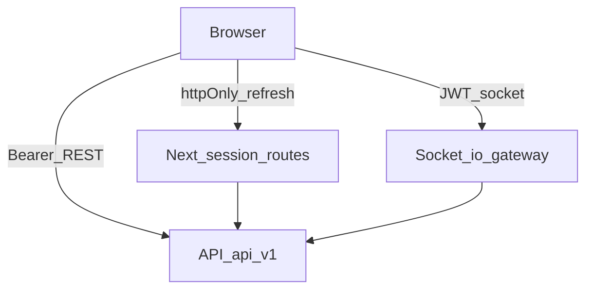

# Frontend ↔ API connection (F3)

Canonical path: `.cursor/docs/api-connection.md`.
Status: DS-117 closed F3 (DS-119 Socket.io, DS-120 Notion sync retry, DS-121 async reports, DS-122 global errors + ConnectionStatus). DS-118 closed Chat General UI (DS-123 cursor/idempotent send, DS-124 `/general` presence + live messages).
Language: English documentation; Spanish user-facing copy.

Related: `.cursorrules` · `AGENTS.md` · `.cursor/rules/api-integration.mdc` · `.cursor/docs/SCREENS.md` · `.cursor/docs/frontend-conventions.md`

This file is the **operational connection guide**. Enforcement rules for agents live in `.cursor/rules/api-integration.mdc`. Screen inventory: `.cursor/docs/SCREENS.md`.



## 1. Environment

Validated once in [`src/config/env.ts`](../../src/config/env.ts) (Zod). Never read `process.env` elsewhere.

| Variable                 | Example                                        | Role                                                             |
| ------------------------ | ---------------------------------------------- | ---------------------------------------------------------------- |
| `NEXT_PUBLIC_API_URL`    | `https://quantiaapi-production.up.railway.app` | API origin **without** `/api/v1`. REST client appends `/api/v1`. |
| `NEXT_PUBLIC_SOCKET_URL` | same origin as API in most deploys             | Socket.io gateway origin. Namespaces are appended by the client. |

- Both are public (`NEXT_PUBLIC_*`). No tokens, keys, or secrets.
- Template: [`.env.example`](../../.env.example). Local: copy to `.env.local`.
- CORS is enforced by the API; a non-allowlisted origin fails in the browser with no readable body.

## 2. HTTP client

**Single entry:** [`src/lib/api/client.ts`](../../src/lib/api/client.ts) via domain helpers in `src/lib/api/*.ts` (barrel [`index.ts`](../../src/lib/api/index.ts)).

| Concern | Behaviour                                                                                                                                  |
| ------- | ------------------------------------------------------------------------------------------------------------------------------------------ |
| Auth    | `Authorization: Bearer` from in-memory access token (`src/lib/api/session.ts`)                                                             |
| 401     | One silent `refreshAccessToken` (single-flight) + one retry; failure → `expireSession` → OVR-04                                            |
| 429     | Wait `Retry-After` (capped for the silent retry) then one automatic retry; UI uses full seconds via `ApiError.retryAfterSeconds`           |
| Errors  | Normalized `ApiError` (`kind`, `status`, `retryAfterSeconds`). Page mapping: [`errorStatePropsFromApiError`](../../src/lib/api/errorUi.ts) |
| Types   | Request/response/query from `@quantia/contracts` only                                                                                      |
| Cache   | React Query (`src/lib/query/`); keys in `src/lib/api/query-keys.ts`                                                                        |

No ad-hoc `fetch` in components. Components never import `lib/api` directly; features/hooks own calls.

## 3. Session

| Piece       | Location                                                                            | Notes                                                |
| ----------- | ----------------------------------------------------------------------------------- | ---------------------------------------------------- |
| Access JWT  | Memory only                                                                         | Never `localStorage` / `sessionStorage`              |
| Refresh     | httpOnly cookie `Path=/api/session`                                                 | Set by Next route handlers                           |
| Handlers    | [`src/app/api/session/{login,refresh,logout}/route.ts`](../../src/app/api/session/) | Forward to API; never return refresh to JS           |
| Boot        | `AuthProvider` → refresh → `GET /users/me`                                          | Roles drive navigation (never JWT decode)            |
| Tabs        | `BroadcastChannel('quantia-auth')`                                                  | One tab rotates refresh; others receive access       |
| Return path | [`src/lib/auth/returnPath.ts`](../../src/lib/auth/returnPath.ts)                    | After 401 → `/login?from=…` → restore if `canAccess` |

Logout clears access token, drafts (unless expired-session keep), session report jobs, and disconnects all sockets.

## 4. Socket.io (DS-119)

| File                                                              | Role                                                                              |
| ----------------------------------------------------------------- | --------------------------------------------------------------------------------- |
| [`connection.ts`](../../src/lib/socket/connection.ts)             | `io(NEXT_PUBLIC_SOCKET_URL + namespace)`, JWT in `auth.token`, budget / reconnect |
| [`SocketProvider.tsx`](../../src/lib/socket/SocketProvider.tsx)   | Shell `/notifications`; connection state for header; session notices              |
| [`useProjectSocket.ts`](../../src/lib/socket/useProjectSocket.ts) | `/projects` while a project view is mounted; `join` + contract events             |
| [`useGeneralSocket.ts`](../../src/lib/socket/useGeneralSocket.ts) | `/general` while `/chat` is mounted; presence + `mensaje-creado`                  |
| [`events.ts`](../../src/lib/socket/events.ts)                     | Zod-validated contract payloads (project + chat general)                          |

**Namespaces**

| NS               | When connected                 |
| ---------------- | ------------------------------ |
| `/notifications` | Authenticated shell            |
| `/projects`      | Project workspace mounted      |
| `/general`       | Chat General (`/chat`) mounted |

Server budget: **10** simultaneous connections per user across tabs/namespaces (`WS_MAX_CONNECTIONS_PER_USER`, API v0.1.0+). Exceeding → pause realtime in this tab (`connectionPaused`); REST continues.

**Contract realtime events (v0.8.0):**

- Projects / notifications: `tarea.actualizada`, `avance.registrado`, `proyecto.retrasado`, `presupuesto.ejecucion-baja`.
- Chat General (`/general`, v2): `presencia`, `usuario-conectado`, `usuario-desconectado`, `usuario-actualizado`, `mensaje-creado`, `mensaje-editado`, `mensaje-eliminado`, `reacciones-actualizadas`, `escribiendo`, `lectura` (all prefixed `chat.general.`) plus `error { code }`. Client → server with ack: `chat.general.escribiendo { isTyping }`, `chat.general.reautenticar { token }`. Room `general` is joined automatically by the server (no client `join`).

Events invalidate/patch React Query; they are not the source of truth. After reconnect: re-join (projects) or refetch (chat history) + presence snapshot.

**UI:** [`ConnectionStatus`](../../src/components/system/ConnectionStatus/ConnectionStatus.tsx) in `AppHeader` (`aria-live="polite"`). Hidden when `connected`. Copy: «Datos posiblemente desactualizados» / «Reconectando…».

**Not in contract — do not subscribe:** `reporte.completado`, `sync.failed`.

### Chat General v2 (contracts 0.8.0)

Semillero-wide channel (not per project). Route: `/chat` → [`GeneralChatScreen`](../../src/features/chat-general/GeneralChatScreen.tsx) for all authenticated roles. Source of truth: `Quantia_API/docs/development/chat-e2e-integration.md`.

| Layer        | Implementation                                                                                                                                                                                                                                                                                                                                                                                                                                            |
| ------------ | --------------------------------------------------------------------------------------------------------------------------------------------------------------------------------------------------------------------------------------------------------------------------------------------------------------------------------------------------------------------------------------------------------------------------------------------------------- |
| REST         | [`lib/api/chat.ts`](../../src/lib/api/chat.ts): `state`, history cursor, `updates` feed, send (idempotent `clientMessageId`, optional `replyToId`), edit, delete, reaction put/delete, `read`. Avatars in [`lib/api/users.ts`](../../src/lib/api/users.ts). `ApiError.code` carries the stable API `code`.                                                                                                                                                |
| Store        | [`chatReducer.ts`](../../src/features/chat-general/chatReducer.ts): order by `seq`, merge by `version` (idempotent), optimistic swap keyed by `clientMessageId`, tombstones mark quotes deleted, read pointers, reaction pop token. Unit-tested.                                                                                                                                                                                                          |
| Orchestrator | [`useGeneralChat.ts`](../../src/features/chat-general/useGeneralChat.ts): REST bootstrap (independent of the socket) → buffer socket events until hydrated → catch up with `/updates?since=syncPoint−5s` after every reconnect (reload first page if > 24 h). Send retries once on network/5xx with the same `clientMessageId`; 4xx → `failed` (Reintentar/Descartar).                                                                                    |
| Socket       | [`useGeneralSocket.ts`](../../src/lib/socket/useGeneralSocket.ts): ready on `presencia`; presence + «recientemente» (`lastSeenAt`); typing timers by `expiresInMs`, emit throttled to `typingTtlMs/2`; `reautenticar` on every new access token (own refresh or another tab, `onAccessTokenChange`); `io server disconnect` → manual reconnect with backoff; `AVATAR_REQUIRED` / `CHAT_DISABLED` / `TOO_MANY_CONNECTIONS` stop retries with their own UI. |
| Avatar       | `avatarRequired` → blocking [`AvatarPickerPanel`](../../src/features/chat-general/AvatarPickerPanel.tsx) (`PATCH /users/me/avatar`, then `AuthProvider.replaceUser`). Glyphs bundled in [`Avatar`](../../src/components/base/Avatar/avatarArt.tsx) (`avatarKey`).                                                                                                                                                                                         |
| Shell        | [`useChatUnread`](../../src/features/chat-general/useChatUnread.ts) polls `GET /state` (60 s, focus) for the «Chat» nav badge; 404 `CHAT_DISABLED` hides the nav entry. No socket outside `/chat`.                                                                                                                                                                                                                                                        |
| UX / motion  | Telegram-like groups (< 5 min), day separators, frozen «Mensajes nuevos» divider, ✓/✓✓ «Visto por N», reply quotes with jump + 1.6 s highlight, edit (↑ on empty composer), delete with `ConfirmDialog` (Admin moderates), 8 allowlisted reactions with pop, typing dots, «N mensajes nuevos» pill, scroll anchor on older pages. Motion layout/presence + GSAP first-paint stagger; all honour reduced motion.                                           |

#### v1 notes (DS-118, still valid)

| Layer         | Implementation                                                                                                                                     |
| ------------- | -------------------------------------------------------------------------------------------------------------------------------------------------- |
| REST history  | `GET /chat/general/messages?cursor&limit` via [`lib/api/chat.ts`](../../src/lib/api/chat.ts); infinite query + Virtuoso (load older upward)        |
| REST send     | `POST /chat/general/messages` with stable `clientMessageId`; optimistic `sending → sent → failed` + retry; 429 countdown on composer               |
| Socket        | [`useGeneralSocket`](../../src/lib/socket/useGeneralSocket.ts) only while `/chat` is mounted; disconnect on unmount                                |
| Presence      | `PresenceList` from `presencia` / connect / disconnect; rail on `md+`, Sheet on compact                                                            |
| Live messages | Patch React Query on `mensaje-creado`; dedupe by `id` / `clientMessageId` ([`chatCache.ts`](../../src/lib/api/chatCache.ts) + `mergeChatMessages`) |
| Scroll / a11y | No auto-scroll when reading history; pill «N mensajes nuevos»; polite live region for remote authors; composer keeps focus after send              |
| Disabled chat | REST 404 → hide/unavailable ErrorState; no reconnect loop                                                                                          |

UI states: Skeleton (first load), EmptyState «Aún no hay mensajes», sending/failed on `ChatMessage`, rate-limit on composer, reconnect via PresenceList `ConnectionStatus`.

## 5. React Query + live updates

- Provider: [`src/lib/query/QueryProvider.tsx`](../../src/lib/query/QueryProvider.tsx).
- Socket handlers invalidate or patch domain keys; highlight rows 1–2 s; never reorder under the cursor ([`useFrozenListOrder`](../../src/lib/socket/useFrozenListOrder.ts)).
- `syncStatus` is **not** on socket payloads → refetch the resource after relevant events.

## 6. Notion sync (DS-120)

Applies to **projects, tasks, progress** (`syncStatus: PENDING | SYNCED | FAILED`).

| State     | UI                                                    |
| --------- | ----------------------------------------------------- |
| `PENDING` | «Sincronizando con Notion» — user keeps working       |
| `FAILED`  | Failure banner; Quantia data remains valid (editable) |
| `SYNCED`  | Quiet / no banner                                     |

**Admin retry (provisional):** `POST /api/v1/sync/:entityType/:id/retry` via [`src/lib/api/sync.ts`](../../src/lib/api/sync.ts) + [`useRetrySync`](../../src/features/sync/useRetrySync.ts). Only `ADMINISTRADOR` (`canRetrySync`). Response schemas still pending in `@quantia/contracts`; treat as provisional until the backend lands formal contracts.

No `sync.failed` socket event — UI follows REST `syncStatus` + invalidate/poll.

## 7. Async reports (DS-121)

| Step       | Implementation                                                                                                                         |
| ---------- | -------------------------------------------------------------------------------------------------------------------------------------- |
| Enqueue    | `POST …/projects/:id/reports` → [`createProjectReport`](../../src/lib/api/reports.ts)                                                  |
| Persist    | [`sessionReportsStore`](../../src/features/reports/sessionReportsStore.ts) — memory + `sessionStorage` key `quantia.sessionReports.v1` |
| Poll       | [`pollWithBackoff`](../../src/lib/async/pollWithBackoff.ts) via [`useSessionReports`](../../src/features/reports/useSessionReports.ts) |
| Ready      | Toast «Reporte listo» + Descargar; `pushSessionNotice(noticeFromReportReady)`                                                          |
| Failed     | Toast/error without raw `errorMessage`; new POST on retry                                                                              |
| Busy / 429 | `isBusy(projectId, kind)` + [`useRateLimitLock`](../../src/lib/async/useRateLimitLock.ts)                                              |

Completion signal is **poll `READY`/`FAILED`**, not a socket. Screens: `ReportsScreen`, `ExportReportPanel`.

## 8. Global errors (DS-122)

| Kind                      | Presentation                                                                                 |
| ------------------------- | -------------------------------------------------------------------------------------------- |
| 401 (after refresh fails) | `ErrorState variant="session"` (OVR-04); return via `from`                                   |
| 403                       | `ErrorState` «No tienes acceso» + Volver (shell + screens); no resource disclosure           |
| 429                       | Countdown from `Retry-After`; action disabled (`useRateLimitLock` / `ErrorState rate-limit`) |
| 5xx                       | `ErrorState server` + Reintentar                                                             |
| Network                   | Same variant with «Revisa tu conexión…» (`errorStatePropsFromApiError`)                      |
| Next boundary             | [`src/app/error.tsx`](../../src/app/error.tsx) uses `ErrorState`                             |

## 9. Smoke checklist (manual / staging)

Run against a live API when available. Automated suite covers unit/component paths (`npm test`).

**DS-119 — Socket**

- [ ] Login → `/notifications` connected; open project → `/projects` + successful `join`.
- [ ] Task update in another session → in-place patch + brief highlight; no focus steal.
- [ ] Extra tabs near connection budget → «Tiempo real pausado en esta pestaña»; REST still works.
- [ ] Disconnect → ConnectionStatus banner + Reconectar; reconnect clears banner and refetches.

**DS-120 — Sync**

- [ ] Entity with `FAILED` → SyncStatus banner; data remains editable.
- [ ] Admin sees «Reintentar» and calls provisional retry; non-admin does not.

**DS-121 — Reports**

- [ ] Generate → job appears in session tray; navigate away and back → polling continues.
- [ ] `READY` → toast + download (re-GET if URL expired); no `reporte.completado` subscription.

**DS-122 — Errors**

- [ ] Deep-link while anonymous → `/login?from=…` → restore authorized path after login.
- [ ] Forbidden catalog path → «No tienes acceso» + Volver.
- [ ] Login 429 → countdown; submit disabled until unlock.

## 10. Contract gaps (do not invent)

Aligned with SCREENS §10 and `api-integration.mdc` §12:

| Need                       | Contract v0.8.0                                           | Frontend until backend lands                                      |
| -------------------------- | --------------------------------------------------------- | ----------------------------------------------------------------- |
| `reporte.completado`       | Absent                                                    | Polling + Toast (DS-121)                                          |
| `sync.failed`              | Absent                                                    | REST `syncStatus` + refetch                                       |
| Sync retry schemas         | `SyncEntityType` only; POST response not fully contracted | Provisional `POST /sync/:entityType/:id/retry` for admin (DS-120) |
| Extra event payload fields | Not on realtime events                                    | Refetch resource                                                  |

## 11. Verification gate (DS-117 / DS-118)

Automated on every F3-related PR:

```bash
npm run lint && npm run typecheck && npm run test && npm run build
```

Key tests: `src/lib/socket/*` (incl. `chatEvents`, `presenceMap`), `src/lib/api/sync.test.ts`, `src/features/reports/*`, `src/lib/api/errorUi.test.ts`, `src/lib/auth/returnPath.test.ts`, `ConnectionStatus` / `AppShell` tests.

Chat General (DS-118): `ChatMessage` / `MessageComposer` / `PresenceList` component tests; `mergeChatMessages` / `groupMessagesByDay` feature tests.
